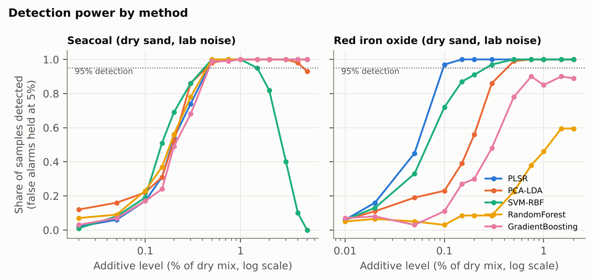

# Green Sand Near-Infrared Reference Library

**Status:** Released v1.0.0 | **Maintainer:** Maurice Kuubata, [ORCID 0009-0003-3178-5971](https://orcid.org/0009-0003-3178-5971) | **License:** code MIT, data CC BY 4.0 | **DOI:** [10.5281/zenodo.24568108](https://doi.org/10.5281/zenodo.24568108) (all versions: [10.5281/zenodo.24568107](https://doi.org/10.5281/zenodo.24568107))

**In plain terms:** foundries still check their sand with slow tests like loss on ignition, so a bad batch can reach the mold line before the result comes back. Near-infrared (NIR) sensors could check sand in seconds, but there is no public, shared reference for which additive levels such a sensor can reliably detect. This project provides an open set of 4,410 computed green sand spectra (plus 6,930 moist-sand spectra), a fixed test that measures the smallest amount of seacoal or red iron oxide a method can detect, and a Python package to reproduce and extend all of it.

New here? Read [docs/START_HERE.md](docs/START_HERE.md). Terms are explained in [docs/GLOSSARY.md](docs/GLOSSARY.md).

## What this is

A versioned library of computed near-infrared reflectance spectra of foundry green sand (silica sand, bentonite, seacoal, red iron oxide, water) across production ranges: 3-12% clay, 0-5% seacoal, 0-2% iron oxide and, in the moisture extension, 2-5% water. Spectra are computed from USGS Spectral Library Version 7 reference spectra with Hapke (single-scattering albedo) mixing, calibrated against 24 measured dry mixtures from Kuubata (2025, University of Northern Iowa), and provided both at 1 nm and resampled to the 1000-2350 nm InGaAs instrument class used in that study (195 channels, 6.93 nm spacing). A detection-limit benchmark scores any calibration method with one rule: false alarms on clean sand held at 5%, detection limit = lowest level caught in at least 95% of samples, at that level and above.

## Headline results

- The calibrated model reproduces **5/5** of the laboratory trends checked (first principal component 99.78% for seacoal vs 99.23% measured; 95.61% for red iron oxide vs 97.87% measured). With the assumed starting particle sizes (no lab calibration) the model reproduces 3/5; with simple linear mixing, 2/5.
- **Partial least squares regression (PLSR)**, lab-grade noise, dry sand: seacoal detected from **0.5%**, red iron oxide from **0.1%**. Plant-floor noise: 0.75% and 0.15%. Moist sand (2-5% water), lab noise: 0.5% and 0.15%.
- Present-or-absent machine-learning classifiers can miss high additive levels they were not tuned for; see the leaderboard column "misses higher levels".



## What is here

```
config/mixing_rules.json   every mixing rule and assumption (the author sets these)
code/                      numbered pipeline scripts, run in order
src/greensand_nir/         the Python package (mixing, water, instrument, preprocessing, PLSR, benchmark)
library/v1.0/              dry library: compositions + spectra (1 nm and instrument resolution)
library/moisture/          moisture extension
benchmark/sets/            12 benchmark sets (calibration + test), leaderboard.csv, power_curves.csv
data/raw/                  inputs with PROVENANCE.txt; data/processed/ QA report and calibration
docs/                      START_HERE, GLOSSARY, CODEBOOK, MIXING_RULES, LIMITATIONS, VERIFY_CHECKLIST,
                           PUBLISH_GUIDE, TALK_TRACK, NEXT_STEPS, leaderboard/ (web page)
paper/                     stats.json, figures, JOSS paper draft
tests/                     automated tests (pytest)
```

## Run it

```
pip install -e ".[figures,test]"
python code/01_fetch.py            # download USGS + water data, log provenance
python code/02_calibrate_to_lab.py # fit seacoal and iron oxide effective sizes to the lab AUC values
python code/03_build_library.py    # library v1.0 + moisture extension + QA report
python code/04_lab_trends.py       # repeat the lab analysis on computed spectra
python code/05_benchmark.py        # benchmark sets, baselines, leaderboard, sensitivity
python code/06_figures.py          # figures + leaderboard page
python code/07_build_docs.py       # documents from stats.json
python code/09_preprint_assets.py  # preprint figures, tables and number macros
cd paper/preprint && pdflatex main && bibtex main && pdflatex main && pdflatex main && cd ../..
pytest
```

The whole pipeline runs in a few minutes on a laptop. Outputs are deterministic (fixed random seeds).

## Use the package

```python
import greensand_nir as g
rules = g.io.load_rules("config/mixing_rules.json")
E = g.io.load_endmembers(rules, "data/raw/splib07_selected")
E.grain_um.update(seacoal=37.7, iron_oxide=2.48)
R = g.mixing.mix(E.matrix(["silica_sand", "clay", "seacoal", "iron_oxide"]),
                 [0.885, 0.08, 0.03, 0.005],
                 [E.density[k] for k in ["silica_sand", "clay", "seacoal", "iron_oxide"]],
                 [E.grain_um[k] for k in ["silica_sand", "clay", "seacoal", "iron_oxide"]],
                 moisture_pct=3.5, water_alpha=E.water_alpha)
ins = g.instrument.Instrument(rules, E.wl)
reading = ins.measure(R.reshape(1, -1), tier="lab", rng=0)   # simulated instrument reading
```

## Submit a method to the leaderboard

Train on `benchmark/sets/<set>_calibration.csv.gz`, score every row of `<set>_test.csv.gz` (higher = more additive), then run `python code/score_submission.py --set <set> --scores scores.csv --method "name" --submitted-by "you" --append` and open a pull request. Leaderboard page: `docs/leaderboard/index.html` (published with GitHub Pages).

## Sources

| Source | Vintage | License | Accessed |
|---|---|---|---|
| Kokaly et al., USGS Spectral Library Version 7 Data, https://doi.org/10.5066/F7RR1WDJ | 2017 | US public domain | 2026-11-20 |
| Segelstein (1981), liquid water optical constants, via refractiveindex.info database | 1981 | CC0 | 2026-11-20 |
| Kuubata (2025), NIR Spectroscopy as a Tool for Identifying Additives in Foundry Green Sands, UNI, https://scholarworks.uni.edu/grp/4669 | 2025 | author's own work; 24 values transcribed | 2026-11-20 |

## Limitations

Read [docs/LIMITATIONS.md](docs/LIMITATIONS.md) before using or citing anything here. The short version: these are computed spectra, calibrated to one small dry laboratory study. They show what is detectable in principle under stated assumptions, not what a particular sensor will achieve in a particular plant.

## Citation

See `CITATION.cff`. Kuubata, M. (2026). Green Sand Near-Infrared Reference Library and Detection-Limit Benchmark (v1.0.0). Zenodo. https://doi.org/10.5281/zenodo.24568108

## How this was built

Claude (Anthropic) assisted with code and data handling. Maurice Kuubata set every mixing rule and verified every output.
